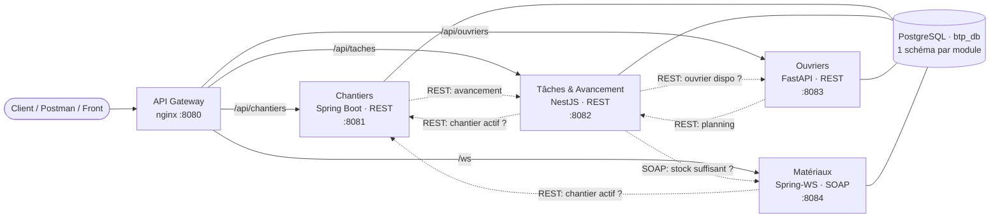

# BTP Chantiers

**Piloter des chantiers du BTP depuis une seule application : planification des tâches, affectation des ouvriers, suivi des matériaux et avancement en temps réel.**

[](https://github.com/MohamedOuijjane/btp-chantiers/actions/workflows/ci.yml)
[](https://github.com/MohamedOuijjane/btp-chantiers/actions/workflows/codeql.yml)
[](https://sonarcloud.io/summary/new_code?id=MohamedOuijjane_btp-chantiers)
[](https://sonarcloud.io/component_measures?id=MohamedOuijjane_btp-chantiers&metric=coverage)
[](LICENSE)
[](https://github.com/MohamedOuijjane/btp-chantiers/releases)

> Projet de Master Ingénierie Logicielle (S3), Faculté des Sciences Agadir, Université Ibn Zohr · modules Web Services et Qualité Logicielle · Équipe 18 · 2026-2027

## Sommaire

- [Problème et solution](#problème-et-solution)
- [Architecture](#architecture)
- [Démarrage rapide](#démarrage-rapide)
- [Structure du dépôt](#structure-du-dépôt)
- [Développement](#développement)
- [Qualité](#qualité)
- [Méthode agile](#méthode-agile)
- [Équipe](#équipe)
- [Documentation](#documentation)

> Master d'Excellence Ingénierie Logicielle (S3), Faculté des Sciences Agadir, Université Ibn Zohr
> Modules **Web Services** et **Qualité Logicielle**, Pr. IDRAIS, 2026-2027
> **Équipe 18** : OUIJJANE Mohamed (chef de projet), IJJAALI Houssam, BENZINEB Ilyas, Hatim

- **Problème :** dans beaucoup de PME du BTP, le suivi des chantiers se fait sur papier ou dans des fichiers Excel dispersés : retards, ruptures de stock et aucune vision de l'avancement réel.
- **Solution :** une application web qui centralise chantiers, tâches, ouvriers et matériaux, et calcule automatiquement l'avancement de chaque chantier.
- **Approche :** 4 microservices hétérogènes (Java, TypeScript, Python) qui communiquent par **REST/JSON** et **SOAP/XML**, conteneurisés avec Docker.

## Architecture



| Module | Responsable | Stack | Protocole | Schéma (base `btp_db`) | Port |
|---|---|---|---|---|---|
| **Chantiers** | OUIJJANE Mohamed | Java 21 · Spring Boot 3 | REST / JSON | `chantiers` | 8081 |
| **Tâches & Avancement** | IJJAALI Houssam | TypeScript · NestJS 10 | REST / JSON | `taches` | 8082 |
| **Ouvriers** | BENZINEB Ilyas | Python 3.12 · FastAPI | REST / JSON | `ouvriers` | 8083 |
| **Matériaux** | SALHI Hatim | Java 21 · Spring-WS | **SOAP / XML (WSDL)** | `materiaux` | 8084 |
| **Front-end** | OUIJJANE Mohamed | React 18 · Vite · TypeScript | via la gateway | n/a | 8080 |
| **Gateway** | OUIJJANE Mohamed | nginx | reverse proxy | n/a | **8080** |

Toute l'application partage **une seule base PostgreSQL** (`btp_db`). Chaque module possède son propre schéma et son propre utilisateur, sans aucun droit sur les schémas des autres : voir [ADR-0005](docs/adr/0005-base-de-donnees-unique.md).

> Migration en cours vers la base unique : Tâches (MongoDB, #6) et Matériaux (MySQL, #17) ; front-end en cours de réalisation ([architecture](docs/frontend/architecture.md), #24).

Les choix d'architecture sont justifiés dans les [ADR](docs/adr/) et les échanges entre modules sont détaillés dans [docs/architecture.md](docs/architecture.md).

## Démarrage rapide

**Prérequis :** Docker Desktop (ou Docker Engine avec Compose v2).

```bash
git clone https://github.com/MohamedOuijjane/btp-chantiers.git
cd btp-chantiers
cp .env.example .env               # optionnel
docker compose up --build -d --wait   # ou : make up
docker compose ps                  # tous les services doivent être "healthy"
./scripts/demo.sh                  # scénario de démonstration de bout en bout
```

| Accès | URL |
|---|---|
| Application (front-end) | http://localhost:8080 |
| Swagger Chantiers | http://localhost:8081/swagger-ui.html |
| Swagger Tâches | http://localhost:8082/swagger-ui |
| Swagger Ouvriers | http://localhost:8083/swagger-ui |
| WSDL Matériaux | http://localhost:8080/ws/materiaux.wsdl |
| Santé de la gateway | http://localhost:8080/health |

Une collection Postman prête à importer est disponible : [`docs/api/btp-chantiers.postman_collection.json`](docs/api/btp-chantiers.postman_collection.json).

## Structure du dépôt

```
btp-chantiers/
├── services/
│   ├── chantiers-service/    # Spring Boot, REST
│   ├── taches-service/       # NestJS, REST + client SOAP
│   ├── ouvriers-service/     # FastAPI, REST
│   └── materiaux-service/    # Spring-WS, SOAP contract-first
├── frontend/                 # React + Vite (en cours)
├── gateway/                  # nginx, point d'entrée unique
├── contracts/                # Contrats partagés (XSD SOAP)
├── docs/
│   ├── architecture.md       # Vue d'ensemble, séquences, règles de gestion
│   ├── api-contracts.md      # Endpoints de chaque module
│   ├── adr/                  # Architecture Decision Records
│   ├── api/                  # Collection Postman
│   ├── frontend/             # Architecture du front-end
│   ├── qualite/              # Plan d'assurance qualité et livrables
│   └── agile/                # Scrum, sprints, revues et rétrospectives
├── scripts/                  # Initialisation de la base, démo
├── .github/                  # CI/CD, formulaires d'issues, CODEOWNERS, Dependabot
├── docker-compose.yml
└── Makefile
```

## Développement

Chaque service peut être lancé seul. Démarrer d'abord la base : `docker compose up -d postgres`.

```bash
# Chantiers / Matériaux
cd services/chantiers-service && mvn spring-boot:run

# Tâches
cd services/taches-service && npm install && npm run start:dev

# Ouvriers
cd services/ouvriers-service && pip install -r requirements-dev.txt && uvicorn app.main:app --reload --port 8083
```

## Qualité

La démarche qualité complète est décrite dans le [Plan d'Assurance Qualité](docs/qualite/PAQ.md).

```bash
make test        # tests de tous les services
```

| Module | Tests | Couverture | Analyse statique |
|---|---|---|---|
| Chantiers | JUnit 5 · MockMvc : CRUD, validation, chantier terminé non modifiable, avancement et mode dégradé | JaCoCo | Checkstyle · SpotBugs |
| Matériaux | Spring-WS Test : opérations SOAP, SOAP Fault sur stock insuffisant | JaCoCo | Checkstyle · SpotBugs |
| Tâches | Jest : orchestration des 3 modules, règle avancement → statut, parsing SOAP | Jest | ESLint · tsc |
| Ouvriers | pytest : CRUD, CIN unique et format, planning et mode dégradé | pytest-cov | ruff |

À chaque push et pull request, la CI exécute les tests et l'analyse de chaque module, envoie les résultats à **SonarCloud** (quality gate), lance **CodeQL** (sécurité), vérifie le titre de la PR (Conventional Commits) et construit les images Docker. Un tag `vX.Y.Z` publie les images sur ghcr.io après un scan **Trivy** et crée la release.

## Méthode agile

Le projet suit **Scrum** en 3 sprints d'une semaine ([détails](docs/agile/scrum.md)) :

| Sprint | Dates | Objectif |
|---|---|---|
| S1 · Conception | 01 → 07/11/2026 | Dossier de conception, migrations PostgreSQL, corrections prioritaires |
| S2 · Développement | 08 → 14/11/2026 | Règles de gestion des modules, front-end |
| S3 · Livraison | 15 → 20/11/2026 | Tests de bout en bout, recette, livraison |

Backlog, epics et planification : [GitHub Project de l'équipe](https://github.com/users/MohamedOuijjane/projects/1).

## Équipe

| Membre | Rôle Scrum | Responsabilités |
|---|---|---|
| OUIJJANE Mohamed | Product Owner · développeur | Chef de projet, besoin métier et backlog ; modules Chantiers, gateway et front-end |
| IJJAALI Houssam | Développeur | Architecture technique ; module Tâches & Avancement |
| BENZINEB Ilyas | Scrum Master · développeur | Animation des cérémonies, responsable qualité (tests, recette, anomalies) ; module Ouvriers |
| SALHI Hatim | Développeur | Module Matériaux (SOAP) |

## Documentation

| Document | Contenu |
|---|---|
| [docs/architecture.md](docs/architecture.md) | Principes, matrice des échanges, séquences, règles de gestion, modèle de données |
| [docs/api-contracts.md](docs/api-contracts.md) | Endpoints REST et opérations SOAP de chaque module |
| [docs/adr/](docs/adr/) | Décisions d'architecture (microservices, technologies, SOAP, résilience, base unique) |
| [docs/frontend/architecture.md](docs/frontend/architecture.md) | Architecture du front-end |
| [docs/qualite/PAQ.md](docs/qualite/PAQ.md) | Plan d'Assurance Qualité |
| [docs/qualite/](docs/qualite/) | Livrables qualité (note de cadrage, cahier des charges, conception, recette) |
| [docs/agile/](docs/agile/) | Scrum, sprints, revues et rétrospectives |
| [CONTRIBUTING.md](CONTRIBUTING.md) | Workflow Git, commits, revue de code, gestion du projet |
| [CHANGELOG.md](CHANGELOG.md) | Historique des versions |
| [SECURITY.md](SECURITY.md) | Signaler une vulnérabilité |
| [CODE_OF_CONDUCT.md](CODE_OF_CONDUCT.md) | Code de conduite |

### Livrables

| Livrable | Échéance | Statut |
|---|---|---|
| Note de cadrage | 17/10/2026 | ✅ Livré |
| Cahier des charges | 03/11/2026 | ⏳ #32 |
| Dossier de conception (UML, contrats) | 07/11/2026 | ⏳ #33 |
| Code, Docker et documentation des API | **20/11/2026** | ⏳ ce dépôt |
| Soutenance | à partir du 26/11/2026 | ⏳ #36 |

## Licence

[MIT](LICENSE) © 2026 Équipe 18
