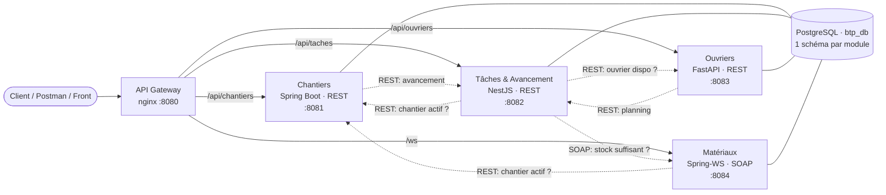

# BTP Chantiers

**Piloter des chantiers du BTP depuis une seule application : planification des tâches, affectation des ouvriers, suivi des matériaux et avancement en temps réel.**

[](https://github.com/MohamedOuijjane/btp-chantiers/actions/workflows/ci.yml)
[](https://github.com/MohamedOuijjane/btp-chantiers/actions/workflows/codeql.yml)
[](https://sonarcloud.io/summary/new_code?id=MohamedOuijjane_btp-chantiers)
[](https://sonarcloud.io/component_measures?id=MohamedOuijjane_btp-chantiers&metric=coverage)
[](LICENSE)
[](https://github.com/MohamedOuijjane/btp-chantiers/releases)

## Sommaire

- [Problème et solution](#problème-et-solution)
- [Architecture](#architecture)
- [Démarrage rapide](#démarrage-rapide)
- [Structure du dépôt](#structure-du-dépôt)
- [Développement](#développement)
- [Qualité](#qualité)
- [Méthode agile](#méthode-agile)
- [Contributeurs](#contributeurs)
- [Documentation](#documentation)

- **Problème :** dans beaucoup de PME du BTP, le suivi des chantiers se fait sur papier ou dans des fichiers Excel dispersés : retards, ruptures de stock et aucune vision de l'avancement réel.
- **Solution :** une application web qui centralise chantiers, tâches, ouvriers et matériaux, et calcule automatiquement l'avancement de chaque chantier.
- **Approche :** 4 microservices hétérogènes (Java, TypeScript, Python) qui communiquent par **REST/JSON** et **SOAP/XML**, conteneurisés avec Docker.

## Architecture



| Module | Responsable | Stack | Protocole | Schéma (base `btp_db`) | Port |
|---|---|---|---|---|---|
| **Chantiers** | OUIJJANE Mohamed | Java 21 · Spring Boot 3 | REST / JSON | `chantiers` | 8081 |
| **Tâches & Avancement** | IJJAALI Houssam | TypeScript · NestJS 10 | REST / JSON | `taches` | 8082 |
| **Ouvriers** | BENZINEB Ilyas | Python 3.12 · FastAPI | REST / JSON | `ouvriers` | 8083 |
| **Matériaux** | SALHI Hatim | Java 21 · Spring-WS | **SOAP / XML (WSDL)** | `materiaux` | 8084 |
| **Front-end** | OUIJJANE Mohamed | React 18 · Vite · TypeScript | via la gateway | n/a | 8080 |
| **Gateway** | OUIJJANE Mohamed | nginx | reverse proxy | n/a | **8080** |

Toute l'application partage **une seule base PostgreSQL** (`btp_db`). Chaque module possède son propre schéma et son propre utilisateur, sans aucun droit sur les schémas des autres : voir [ADR-0005](docs/adr/0005-base-de-donnees-unique.md).

> Les quatre modules sont sur la base unique : Chantiers, Ouvriers, Tâches (schéma `taches`, migrations TypeORM, #6) et Matériaux (schéma `materiaux`, #17).

**Authentification :** la connexion émet un JWT (Chantiers, `POST /api/auth/login`) que la gateway vérifie avant toute requête vers `/api/*` et `/ws`. Tâches, Ouvriers et Matériaux n'ont rien à vérifier : voir [ADR-0006](docs/adr/0006-authentification-jwt-gateway.md).

Les choix d'architecture sont justifiés dans les [ADR](docs/adr/) et les échanges entre modules sont détaillés dans [docs/architecture.md](docs/architecture.md).

## Démarrage rapide

**Prérequis :** Docker Desktop (ou Docker Engine avec Compose v2).

```bash
git clone https://github.com/MohamedOuijjane/btp-chantiers.git
cd btp-chantiers
cp .env.example .env               # obligatoire : secret JWT et mot de passe des comptes de démo
docker compose up --build -d --wait   # ou : make up
docker compose ps                  # tous les services doivent être "healthy"
./scripts/demo.sh                  # scénario de démonstration de bout en bout
```

Sans `.env`, `docker compose` refuse de démarrer (`JWT_SECRET` et `DEMO_MOT_DE_PASSE` manquants). Hors démonstration, remplacer `JWT_SECRET` par un secret généré (`openssl rand -base64 48`).

**Base déjà créée avant l'authentification** (volume `postgres-data` existant) : ajouter le schéma `auth` et son utilisateur, sans perte de données :

```bash
docker compose exec -T postgres sh /docker-entrypoint-initdb.d/init.sh
```

### Comptes de démonstration

Mot de passe commun : celui de `DEMO_MOT_DE_PASSE` dans `.env` (`chantier2026` dans `.env.example`). Sur l'écran de connexion, choisir un profil remplit l'adresse e-mail.

| Profil | E-mail | Accès |
|---|---|---|
| Direction | `nadia.belkadi@souss-batiment.demo` | Tout ; créer, modifier, clôturer un chantier |
| Conducteur de travaux | `samir.haddou@souss-batiment.demo` | Tout, toutes les actions |
| Chef de chantier | `karim.aitali@souss-batiment.demo` | Sans Matériaux ; tâches et ouvriers |
| Magasinier | `fatima.idrissi@souss-batiment.demo` | Tableau de bord, Chantiers, Matériaux ; stock |

Les personnes et la société Souss Bâtiment sont fictives. Après 5 échecs de connexion pour un même e-mail (ou 20 pour une même adresse IP) en 15 minutes, la connexion répond `429`.

| Accès | URL |
|---|---|
| Application (front-end) | http://localhost:8080 |
| Swagger Chantiers | http://localhost:8081/swagger-ui.html |
| Swagger Tâches | http://localhost:8082/swagger-ui |
| Swagger Ouvriers | http://localhost:8083/swagger-ui |
| WSDL Matériaux | http://localhost:8080/ws/materiaux.wsdl |
| Santé de la gateway | http://localhost:8080/health |

Une collection Postman prête à importer est disponible : [`docs/api/btp-chantiers.postman_collection.json`](docs/api/btp-chantiers.postman_collection.json). Elle est autonome (50 requêtes, les 4 modules et l'authentification) : lancée en entier, elle crée ses données, vérifie chaque réponse puis supprime ce qu'elle a créé, sur une base vide comme sur la base de démo. En ligne de commande, stack démarrée : `make postman` (Newman).

## Données de démonstration

`make demo` (stack démarrée : `make up`) remet la base locale à zéro puis la remplit **par les API, via la gateway**, avec les données de l'entreprise fictive Souss Bâtiment :

- 5 chantiers à tous les statuts : Résidence Al Amal et Groupe scolaire Anza (en cours), Villa Benali (planifié), Clinique Argana · extension (suspendu), Entrepôt logistique Aït Melloul (terminé) ;
- 8 ouvriers de spécialités variées, dont un indisponible ;
- 10 matériaux, dont 2 en alerte (Ciment CPJ 45, Fer à béton HA12), et 18 mouvements de stock ;
- 15 tâches à tous les statuts, dont une bloquée avec son motif et une en retard ; l'avancement des chantiers découle de leurs tâches.

**Attention : la remise à zéro efface toutes les données métier** (chantiers, ouvriers, matériaux, mouvements, tâches et leur historique) par un `TRUNCATE … RESTART IDENTITY` sur les 4 schémas. Les comptes de connexion (schéma `auth`) et l'historique des migrations sont conservés. Le script peut être relancé autant de fois que voulu : il repart toujours d'une base vide, sans doublon, avec les mêmes identifiants. Les dates sont calculées à partir du jour du lancement.

Garde-fous :

- **confirmation** : le script demande de taper `oui` ; sans terminal (CI, script), il faut `CONFIRMER=oui make demo`, sinon il s'arrête sans rien modifier ;
- **base locale uniquement** : il refuse de tourner si le conteneur `postgres` n'appartient pas à la stack Docker de ce dépôt, si `DOCKER_HOST` désigne un hôte distant, si la base n'est pas `btp_db` ou si la gateway n'est pas sur `localhost`.

Pour garder les données actuelles, les sauvegarder avant : `docker compose exec -T postgres pg_dump -U btp -d btp_db | gzip > sauvegarde.sql.gz`.

## Structure du dépôt

```
btp-chantiers/
├── services/
│   ├── chantiers-service/    # Spring Boot, REST
│   ├── taches-service-v2/    # NestJS, REST + client SOAP
│   ├── taches-service/       # v1 archivée (remplacée par la v2, ni construite ni testée)
│   ├── ouvriers-service/     # FastAPI, REST
│   └── materiaux-service/    # Spring-WS, SOAP contract-first
├── frontend/                 # React + Vite (en cours)
├── gateway/                  # nginx, point d'entrée unique
├── contracts/                # Contrats partagés (XSD SOAP)
├── docs/
│   ├── architecture.md       # Vue d'ensemble, séquences, règles de gestion
│   ├── api-contracts.md      # Endpoints de chaque module
│   ├── adr/                  # Architecture Decision Records
│   ├── api/                  # Collection Postman
│   ├── frontend/             # Architecture du front-end
│   ├── qualite/              # Plan d'assurance qualité et livrables
│   └── agile/                # Scrum, sprints, revues et rétrospectives
├── scripts/                  # Initialisation de la base, démo
├── .github/                  # CI/CD, formulaires d'issues, CODEOWNERS, Dependabot
├── docker-compose.yml
└── Makefile
```

## Développement

Chaque service peut être lancé seul. Démarrer d'abord la base : `docker compose up -d postgres`.

```bash
# Chantiers / Matériaux
cd services/chantiers-service && mvn spring-boot:run

# Tâches (applique ses migrations au démarrage ; taches_user sur localhost:5432/btp_db)
cd services/taches-service-v2 && npm install && DB_PASSWORD=<TACHES_DB_PASSWORD du .env> npm run start:dev

# Ouvriers
cd services/ouvriers-service && pip install -r requirements-dev.txt && uvicorn app.main:app --reload --port 8083
```

## Qualité

La démarche qualité complète est décrite dans le [Plan d'Assurance Qualité](docs/qualite/PAQ.md).

```bash
make test        # tests de tous les services
make perf        # test de charge JMeter via la gateway (stack démarrée), rapport HTML
make e2e         # tests de bout en bout Playwright (stack démarrée), rapport HTML
make zap         # scan de sécurité OWASP ZAP baseline (stack démarrée), rapport HTML
```

| Module | Tests | Couverture | Analyse statique |
|---|---|---|---|
| Chantiers | JUnit 5 · MockMvc : CRUD, validation, chantier terminé non modifiable, avancement et mode dégradé | JaCoCo | Checkstyle · SpotBugs |
| Matériaux | Spring-WS Test : opérations SOAP, SOAP Fault sur stock insuffisant | JaCoCo | Checkstyle · SpotBugs |
| Tâches | Jest : orchestration des 3 modules, règle avancement → statut, routes HTTP, clients REST et SOAP ; intégration sur PostgreSQL (migrations, requêtes) avec `TEST_DATABASE_URL` | Jest | ESLint · tsc |
| Ouvriers | pytest : CRUD, CIN unique et format, planning et mode dégradé | pytest-cov | ruff |

À chaque push et pull request, la CI exécute les tests et l'analyse de chaque module, envoie les résultats à **SonarCloud** (quality gate), lance **CodeQL** (sécurité), vérifie le titre de la PR (Conventional Commits) et construit les images Docker. Un tag `vX.Y.Z` publie les images sur ghcr.io après un scan **Trivy** et crée la release.

Sécurité : scan baseline [OWASP ZAP](tests/securite/README.md) de la gateway et du front (`make zap`, ou workflow **Sécurité** chaque lundi et à la demande, rapport HTML en artefact).

Test de charge : [JMeter](tests/performance/README.md) (`make perf`, ou workflow **Performance** lancé à la main) ; 20 utilisateurs pendant 60 s, 90e percentile sous 1 s.

Tests de bout en bout : [Playwright](frontend/e2e/README.md) (`make e2e`), et workflow **E2E** à chaque pull request vers `develop` qui touche le front, les services ou la gateway (informatif, rapport HTML en artefact).

## Méthode agile

Le projet suit **Scrum** en 3 sprints d'une semaine ([détails](docs/agile/scrum.md)) :

| Sprint | Dates | Objectif |
|---|---|---|
| S1 · Conception | 01 → 07/11/2026 | Dossier de conception, migrations PostgreSQL, corrections prioritaires |
| S2 · Développement | 08 → 14/11/2026 | Règles de gestion des modules, front-end |
| S3 · Livraison | 15 → 20/11/2026 | Tests de bout en bout, recette, livraison |

Backlog, epics et planification : [GitHub Project](https://github.com/users/MohamedOuijjane/projects/1).

## Contributeurs

| Contributeur | Contributions |
|---|---|
| OUIJJANE Mohamed | Module Chantiers, authentification, gateway et front-end |
| IJJAALI Houssam | Module Tâches & Avancement |
| BENZINEB Ilyas | Module Ouvriers, tests et recette |
| SALHI Hatim | Module Matériaux (SOAP) |

## Documentation

| Document | Contenu |
|---|---|
| [docs/architecture.md](docs/architecture.md) | Principes, matrice des échanges, séquences, règles de gestion, modèle de données |
| [docs/api-contracts.md](docs/api-contracts.md) | Endpoints REST et opérations SOAP de chaque module |
| [docs/adr/](docs/adr/) | Décisions d'architecture (microservices, technologies, SOAP, résilience, base unique) |
| [docs/frontend/architecture.md](docs/frontend/architecture.md) | Architecture du front-end |
| [docs/qualite/PAQ.md](docs/qualite/PAQ.md) | Plan d'Assurance Qualité |
| [docs/qualite/](docs/qualite/) | Documents qualité (cadrage, cahier des charges, conception, recette) |
| [docs/agile/](docs/agile/) | Scrum, sprints, revues et rétrospectives |
| [CONTRIBUTING.md](CONTRIBUTING.md) | Workflow Git, commits, revue de code, gestion du projet |
| [CHANGELOG.md](CHANGELOG.md) | Historique des versions |
| [SECURITY.md](SECURITY.md) | Signaler une vulnérabilité |
| [CODE_OF_CONDUCT.md](CODE_OF_CONDUCT.md) | Code de conduite |

## Licence

[MIT](LICENSE) © 2026 les contributeurs de BTP Chantiers
