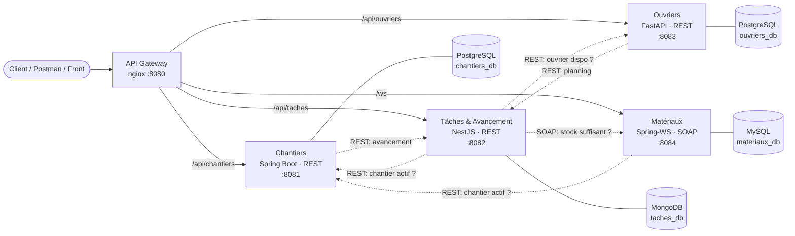

# BTP Chantiers : plateforme distribuée de gestion de chantiers

[](https://github.com/MohamedOuijjane/btp-chantiers/actions/workflows/ci.yml)

Application distribuée qui permet de piloter des chantiers du BTP : planification des tâches, affectation des ouvriers, suivi des matériaux et calcul de l'avancement.
Elle est composée de **4 microservices hétérogènes** qui communiquent par **REST/JSON** et **SOAP/XML**. Chaque service est conteneurisé avec **Docker**.

> Master d'Excellence Ingénierie Logicielle (S3), Faculté des Sciences Agadir, Université Ibn Zohr
> Modules **Web Services** et **Qualité Logicielle**, Pr. IDRAIS, 2026-2027
> **Équipe 18** : OUIJJANE Mohamed (chef de projet), IJJAALI Houssam, BENZINEB Ilyas

---

## Architecture



| Module | Responsable | Stack | Protocole | Base de données | Port |
|---|---|---|---|---|---|
| **Chantiers** | OUIJJANE Mohamed | Java 21 · Spring Boot 3 | REST / JSON | PostgreSQL | 8081 |
| **Tâches & Avancement** | IJJAALI Houssam | TypeScript · NestJS 10 | REST / JSON | MongoDB | 8082 |
| **Ouvriers** | BENZINEB Ilyas | Python 3.12 · FastAPI | REST / JSON | PostgreSQL | 8083 |
| **Matériaux** | *(à attribuer)* | Java 21 · Spring-WS | **SOAP / XML (WSDL)** | MySQL | 8084 |
| **Gateway** | Architecte | nginx | reverse proxy | n/a | **8080** |

Les choix d'architecture sont justifiés dans les [ADR](docs/adr/), et les échanges entre modules sont détaillés dans [docs/architecture.md](docs/architecture.md).

---

## Démarrage rapide

**Prérequis :** Docker Desktop (ou Docker Engine avec Compose v2).

```bash
git clone https://github.com/MohamedOuijjane/btp-chantiers.git
cd btp-chantiers
cp .env.example .env          # optionnel
docker compose up --build -d  # ou : make up
docker compose ps             # tous les services doivent être "healthy"
```

Puis lancer le scénario de démonstration de bout en bout :

```bash
./scripts/demo.sh
```

### Documentation interactive des API

| Service | Documentation |
|---|---|
| Chantiers | http://localhost:8081/swagger-ui.html |
| Tâches | http://localhost:8082/swagger-ui |
| Ouvriers | http://localhost:8083/swagger-ui |
| Matériaux (WSDL) | http://localhost:8084/ws/materiaux.wsdl |

Une collection Postman prête à importer est disponible : [`docs/api/btp-chantiers.postman_collection.json`](docs/api/btp-chantiers.postman_collection.json).

---

## Structure du dépôt

```
btp-chantiers/
├── services/
│   ├── chantiers-service/    # Spring Boot, REST
│   ├── taches-service/       # NestJS, REST + client SOAP
│   ├── ouvriers-service/     # FastAPI, REST
│   └── materiaux-service/    # Spring-WS, SOAP contract-first
├── gateway/                  # Configuration nginx (point d'entrée unique)
├── contracts/                # Contrats partagés (XSD SOAP)
├── docs/
│   ├── architecture.md       # Vue d'ensemble, séquences, règles de gestion
│   ├── api-contracts.md      # Endpoints de chaque module
│   ├── adr/                  # Architecture Decision Records
│   ├── api/                  # Collection Postman
│   └── qualite/              # Livrables QL (note de cadrage, CdC, tests…)
├── scripts/                  # Init BDD, démo end-to-end
├── .github/                  # CI, templates d'issues et de PR, CODEOWNERS
├── docker-compose.yml
└── Makefile
```

---

## Développement

Chaque service peut être lancé seul (base de données locale requise) :

```bash
# Chantiers / Matériaux
cd services/chantiers-service && mvn spring-boot:run

# Tâches
cd services/taches-service && npm install && npm run start:dev

# Ouvriers
cd services/ouvriers-service && pip install -r requirements-dev.txt && uvicorn app.main:app --reload --port 8083
```

### Tests

```bash
make test        # tous les services
```

| Service | Outil | Ce qui est testé |
|---|---|---|
| Chantiers | JUnit 5 · MockMvc | CRUD, validation, règle « chantier terminé non modifiable », avancement agrégé et mode dégradé |
| Matériaux | Spring-WS Test | Opérations SOAP, SOAP Fault sur stock insuffisant |
| Tâches | Jest | Orchestration des 3 modules, règle avancement → statut, parsing SOAP |
| Ouvriers | pytest | CRUD, CIN unique et format, planning et mode dégradé |

La CI GitHub Actions exécute tous les tests et construit toutes les images Docker à chaque push et à chaque pull request.

---

## Contribution

Workflow Git, conventions de commit et revue de code : voir [CONTRIBUTING.md](CONTRIBUTING.md).

## Livrables

| Livrable | Statut | Emplacement |
|---|---|---|
| Note de cadrage | ✅ Livré le 17/10/2026 | [docs/qualite/](docs/qualite/) |
| Cahier des charges | ⏳ 31/10/2026 | docs/qualite/ |
| Dossier de conception (UML, contrats) | ⏳ 07/11/2026 | docs/ |
| Code + Docker + documentation API | ⏳ **20/11/2026** | ce dépôt |
| Soutenance | ⏳ à partir du 26/11/2026 | n/a |
