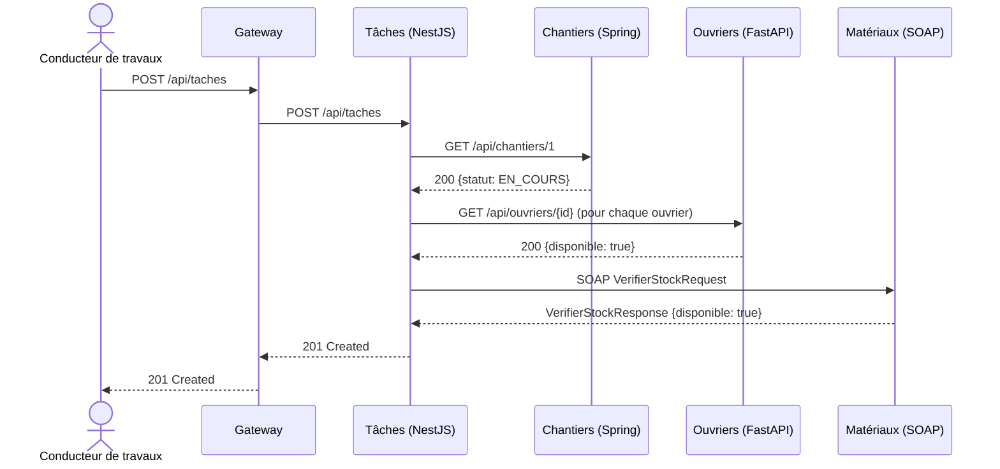
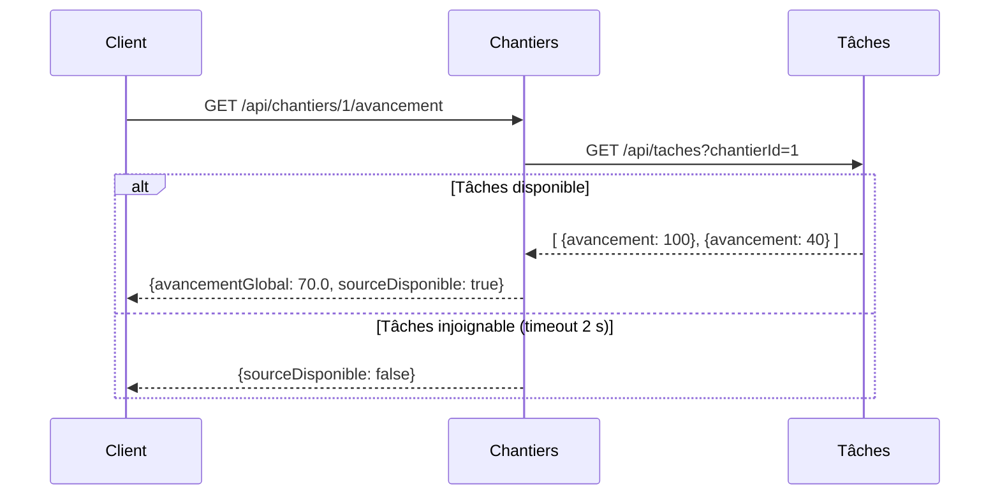
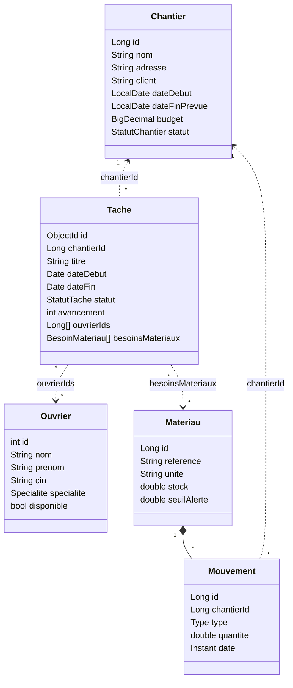

# Architecture

## 1. Principes

| Principe | Mise en œuvre |
|---|---|
| **Autonomie des modules** | Chaque service a son propre code, son Dockerfile, sa base de données et son cycle de tests. |
| **Database per service** | Aucun service ne lit la base d'un autre ; toute donnée externe passe par une API. |
| **Interopérabilité** | 3 langages (Java, TypeScript, Python), 2 protocoles (REST/JSON, SOAP/XML), 3 SGBD. |
| **Contrats explicites** | OpenAPI généré par chaque service REST ; XSD contract-first pour SOAP. |
| **Résilience** | Timeouts de 2 s sur tous les appels sortants ; modes dégradés documentés. |
| **Point d'entrée unique** | Gateway nginx avec propagation d'un `X-Request-Id` pour tracer une requête à travers les services. |

## 2. Matrice des échanges

| Consommateur ↓ / Fournisseur → | Chantiers | Tâches | Ouvriers | Matériaux |
|---|---|---|---|---|
| **Chantiers** | n/a | `GET /api/taches?chantierId` | | |
| **Tâches** | `GET /api/chantiers/{id}` | n/a | `GET /api/ouvriers/{id}` | SOAP `VerifierStock` |
| **Ouvriers** | | `GET /api/taches?ouvrierId` | n/a | |
| **Matériaux** | `GET /api/chantiers/{id}` | | | n/a |

Chaque module **expose** au moins un web service et en **consomme** au moins un, conformément au cahier des charges du projet.

## 3. Scénarios principaux

### 3.1 Création d'une tâche (orchestration de 3 modules)

Si une vérification échoue (chantier terminé, ouvrier indisponible, stock insuffisant), la tâche **n'est pas créée** et l'API renvoie `422` avec un message explicite.

### 3.2 Avancement d'un chantier

## 4. Règles de gestion

| ID | Règle | Module | Code HTTP / SOAP |
|---|---|---|---|
| RG-01 | `dateFinPrevue ≥ dateDebut` pour un chantier | Chantiers | 400 |
| RG-02 | Un chantier `TERMINE` ne peut plus être modifié | Chantiers | 409 |
| RG-03 | On ne crée pas de tâche sur un chantier inexistant ou terminé | Tâches | 404 / 422 |
| RG-04 | Un ouvrier indisponible ne peut pas être affecté | Tâches → Ouvriers | 422 |
| RG-05 | Le statut d'une tâche découle de son avancement (0 % → A_FAIRE, 1–99 % → EN_COURS, 100 % → TERMINEE) | Tâches | n/a |
| RG-06 | La CIN d'un ouvrier est unique et au format marocain | Ouvriers | 409 / 422 |
| RG-07 | Une sortie de stock ne peut pas rendre le stock négatif | Matériaux | SOAP Fault (Client) |
| RG-08 | Un matériau est « en alerte » quand `stock ≤ seuilAlerte` | Matériaux | n/a |
| RG-09 | Tout mouvement de stock est rattaché à un chantier actif | Matériaux → Chantiers | SOAP Fault |

## 5. Modèle de données (vue logique)

Les relations en pointillés sont des **références par identifiant entre services**, pas des clés étrangères : chaque base reste indépendante.

## 6. Procédures dégradées

| Panne | Comportement |
|---|---|
| Tâches indisponible | `Chantiers /avancement` et `Ouvriers /planning` répondent quand même, avec `sourceDisponible: false`. |
| Chantiers / Ouvriers / Matériaux indisponible | La création de tâche est refusée avec `503`, plutôt que d'enregistrer une donnée non vérifiée. |
| Une base de données indisponible | Le healthcheck du service passe en échec et Docker le redémarre (`restart: unless-stopped`). |
