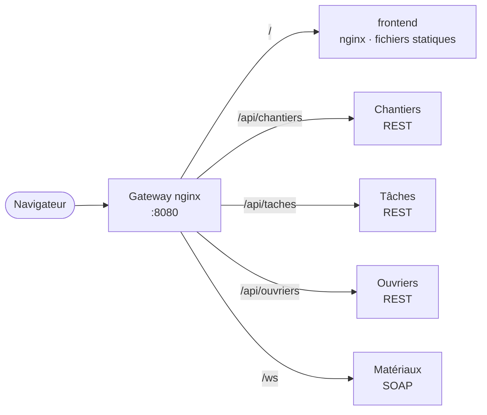
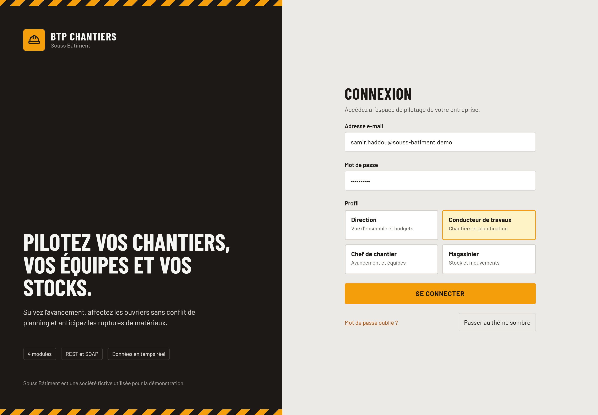
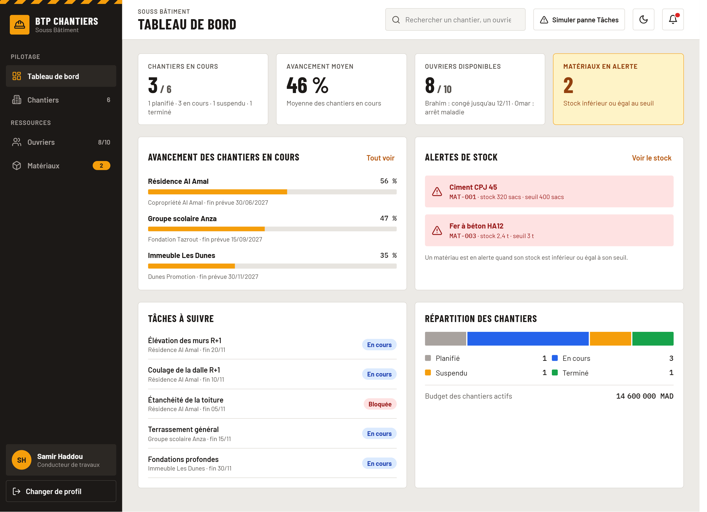
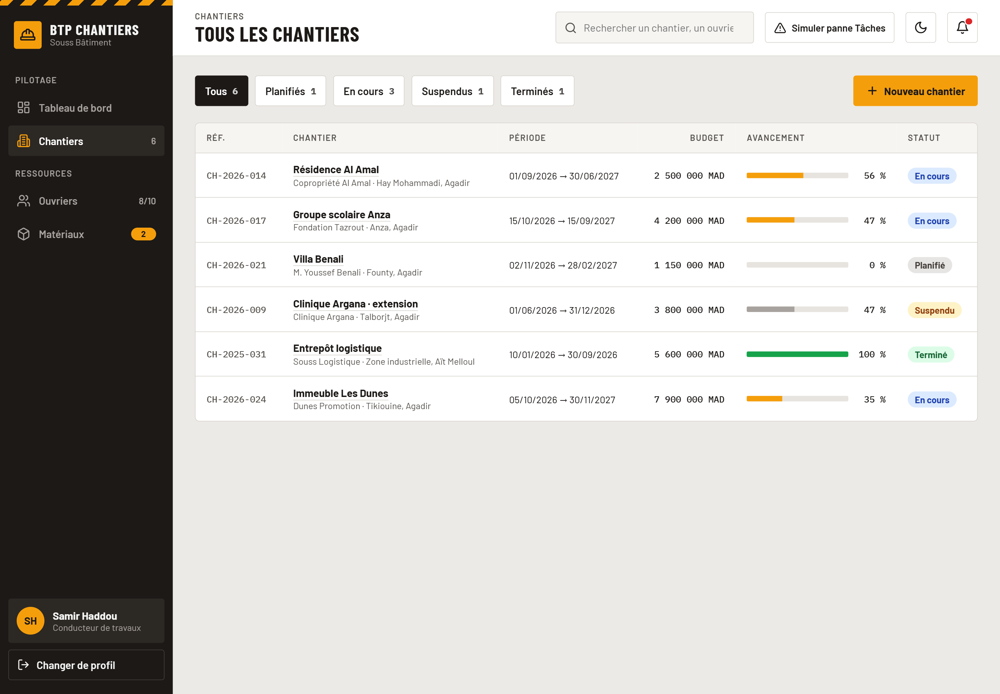
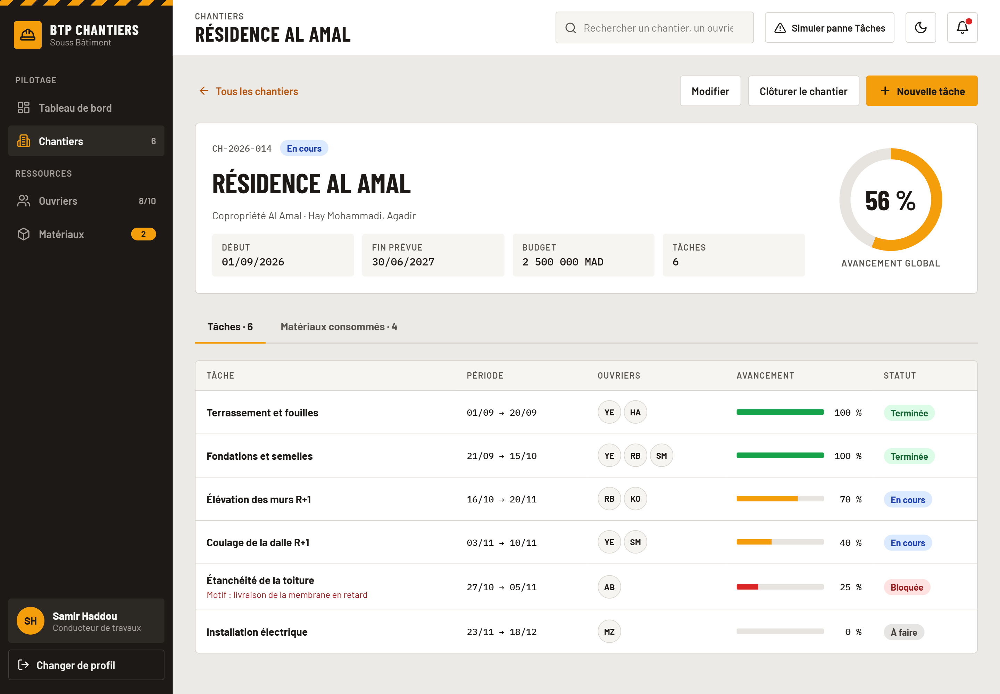
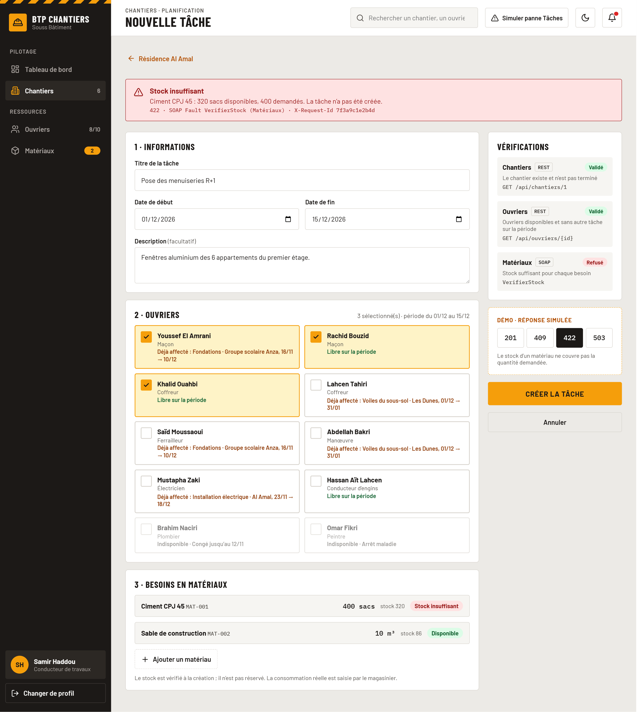
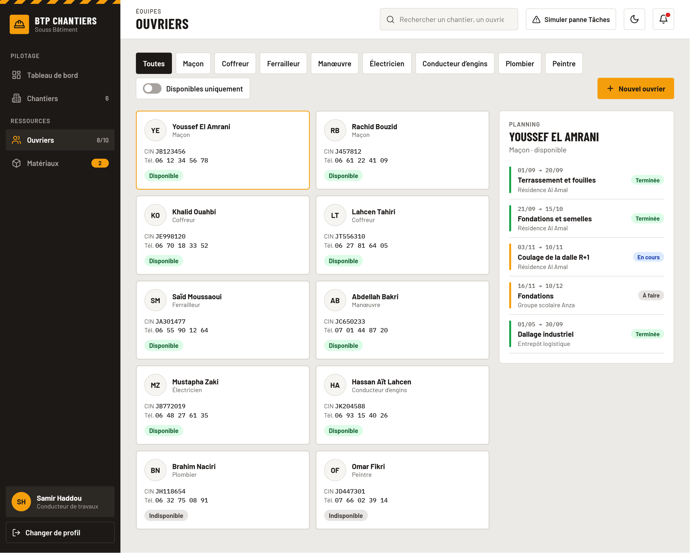
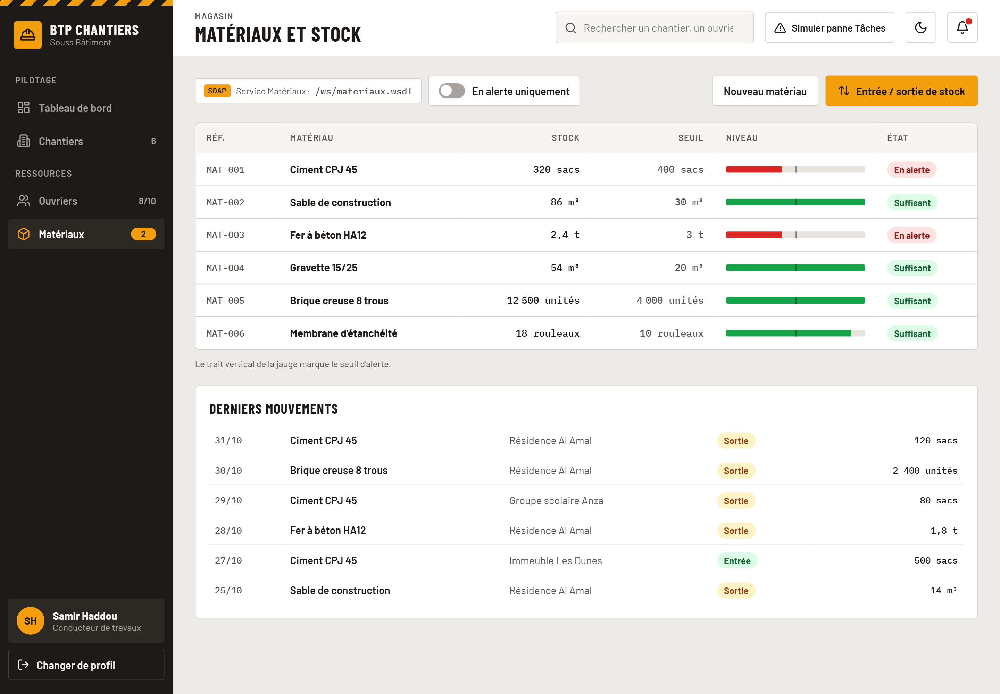
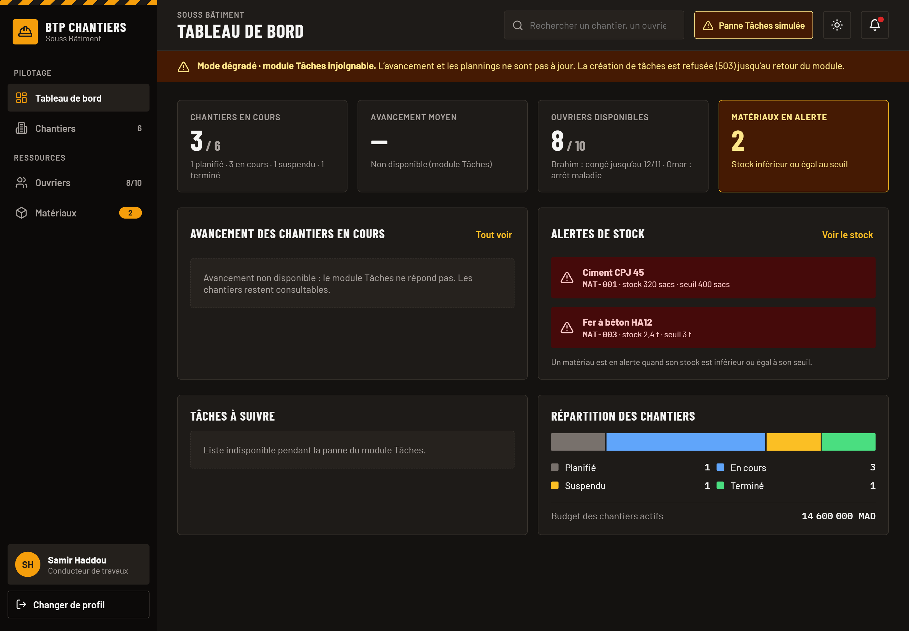

# Architecture du front-end

> Statut : proposé · Dossier du code : `frontend/` (à créer, issue F1)

## 1. Rôle

Le front-end est l'interface web unique de l'application BTP Chantiers. Il s'adresse à quatre profils :

| Profil | Besoin principal | Pages les plus utilisées |
|---|---|---|
| Direction | Vue d'ensemble : chantiers en cours, avancement, budget, alertes | Tableau de bord, Chantiers |
| Conducteur de travaux | Créer et suivre les chantiers, planifier les tâches | Chantiers, Fiche chantier, Nouvelle tâche |
| Chef de chantier | Mettre à jour l'avancement, affecter les ouvriers, signaler un blocage | Fiche chantier (onglet Tâches), Ouvriers |
| Magasinier | Suivre le stock, enregistrer les entrées et sorties | Matériaux |

Le front ne contient **aucune règle de gestion** : il affiche et saisit, les modules backend décident. Une validation côté navigateur (Zod) existe seulement pour le confort de saisie et reprend les mêmes contraintes que l'API.

## 2. Intégration : tout passe par la gateway

Le navigateur ne connaît qu'une seule adresse : la gateway nginx (`http://localhost:8080`). Elle sert le front sur `/` et relaie les appels vers les modules.



Pourquoi passer par la gateway plutôt qu'appeler chaque service :

- **Pas de CORS** : le front et les API sont servis par la même origine, aucune configuration CORS n'est nécessaire dans les 4 modules.
- **Une seule URL** : le front utilise des chemins relatifs (`/api/...`, `/ws`), identiques en développement, en démo et en production.
- **Noms Docker internes** : `chantiers-service:8081` n'existe que dans le réseau Docker ; le navigateur ne peut pas le résoudre.
- **Ports cachés** : à terme, seuls le port 8080 et la base (pour l'administration) restent exposés.
- **Traçabilité** : la gateway ajoute un `X-Request-Id` à chaque requête et le renvoie au navigateur ; une erreur affichée à l'écran peut être retrouvée dans les logs.

**En développement**, le serveur Vite (`npm run dev`, port 5173) redirige `/api` et `/ws` vers `http://localhost:8080` (option `server.proxy` de `vite.config.ts`). Il suffit de lancer le backend avec `docker compose up -d`.

## 3. Stack technique

| Outil | Rôle | Pourquoi |
|---|---|---|
| React 18 + TypeScript | Interface | Standard du marché, typage des réponses d'API. |
| Vite | Build et serveur de dev | Démarrage instantané, proxy intégré vers la gateway. |
| React Router | Routage | Routes imbriquées (fiche chantier et ses onglets), gestion de la page 404. |
| TanStack Query | Données serveur | Cache, rechargement, états de chargement et d'erreur sans code répété. |
| React Hook Form + Zod | Formulaires | Validation typée, peu de re-rendus, schémas réutilisés pour les types. |
| Tailwind CSS + shadcn/ui (Radix) | Design system | Composants accessibles (clavier, ARIA) dont on possède le code. |
| lucide-react | Icônes | Jeu d'icônes cohérent, importées une par une. |
| Recharts | Graphiques | Graphiques React simples pour le tableau de bord. |
| sonner | Notifications | Toasts de succès et d'erreur légers. |
| fast-xml-parser | SOAP | Lecture fiable des réponses XML et des SOAP Faults, sans regex. |
| Vitest + Testing Library + MSW | Tests unitaires | Même configuration que Vite ; MSW simule les API REST et SOAP. |
| Playwright | Tests de bout en bout | Rejoue le scénario de démo dans un vrai navigateur. |
| ESLint + Prettier | Qualité du code | Règles communes et formatage automatique. |

## 4. Arborescence

Le code est organisé **par fonctionnalité** : tout ce qui concerne un module métier est au même endroit.

```
frontend/
├── src/
│   ├── app/                  # point d'entrée, routeur, providers (Query, thème), layout
│   ├── api/
│   │   ├── http.ts           # client REST unique (fetch + normalisation des erreurs)
│   │   ├── soap.ts           # client SOAP (enveloppe, parsing, SOAP Faults)
│   │   └── errors.ts         # type ApiError et conversions
│   ├── features/
│   │   ├── dashboard/
│   │   ├── chantiers/
│   │   ├── taches/
│   │   ├── ouvriers/
│   │   └── materiaux/
│   │       ├── api.ts        # appels du module (fonctions typées)
│   │       ├── hooks.ts      # hooks TanStack Query (useChantiers, useCreerTache…)
│   │       ├── types.ts      # types des réponses
│   │       ├── schemas.ts    # schémas Zod des formulaires
│   │       ├── components/   # composants propres au module
│   │       └── pages/        # pages routées
│   ├── components/
│   │   ├── ui/               # composants shadcn/ui (Button, Dialog, Table…)
│   │   └── common/           # composants partagés (StatutBadge, EtatVide, BandeauDegrade…)
│   └── lib/                  # utilitaires (formatage des dates et montants, cn)
├── e2e/                      # tests Playwright
├── Dockerfile
└── nginx.conf
```

Règle : une page n'appelle jamais `fetch` directement ; elle passe par les hooks de sa fonctionnalité, qui passent par `api/`.

## 5. Couche API

### 5.1 Client REST et erreurs

Les trois modules REST ne renvoient pas leurs erreurs dans le même format. Le client `http.ts` les ramène toutes à un type commun :

```ts
type ApiError = {
  status: number;                     // code HTTP (0 si le réseau est coupé)
  message: string;                    // message lisible à afficher
  champs?: Record<string, string>;    // erreurs par champ (400 / 422 de validation)
  requestId?: string;                 // en-tête X-Request-Id renvoyé par la gateway
};
```

| Module | Format d'erreur reçu | Conversion |
|---|---|---|
| Chantiers (Spring) | RFC 9457 `application/problem+json` : `{ status, detail, erreurs? }` | `message = detail`, `champs = erreurs` |
| Ouvriers (FastAPI) | `{ "detail": "..." }` ou, en validation, `{ "detail": [{ loc, msg }] }` | chaîne → `message` ; tableau → `champs` (dernier élément de `loc`) |
| Tâches (NestJS) | `{ "statusCode", "message", "error" }` (`message` peut être un tableau en validation) | chaîne → `message` ; tableau → liste de messages |

### 5.2 Client SOAP

`soap.ts` expose une fonction `appelSoap(operation, corps)` qui :

1. construit l'enveloppe SOAP 1.1 avec l'espace de noms `http://btp.uiz.ma/materiaux` ;
2. envoie un `POST /ws` avec `Content-Type: text/xml; charset=utf-8` ;
3. lit la réponse avec fast-xml-parser en ignorant les préfixes (`ns2:`, `SOAP-ENV:`) ;
4. transforme une `soap:Fault` en `ApiError` (`status = 422` pour une faute `Client`, `503` pour une faute `Server`, `message = faultstring`).

Chaque opération du contrat (`ListerMateriaux`, `GetMateriau`, `AjouterMateriau`, `EnregistrerMouvement`, `VerifierStock`, puis `ListerMouvements`) a sa fonction typée dans `features/materiaux/api.ts`.

### 5.3 Affichage des erreurs

| Situation | Affichage |
|---|---|
| `400` (ou `422` de validation avec `champs`) | Message sous le champ concerné du formulaire |
| `404` | Page « introuvable » (ressource) ou page 404 (route inconnue) |
| `409` / `422` (règle de gestion) | Message métier dans une alerte du formulaire ou un toast d'erreur |
| `503` ou réseau coupé | Bandeau « Module X indisponible, réessayez dans un instant » |
| Réponse `sourceDisponible: false` | Bandeau « mode dégradé » : données partielles, l'avancement ou le planning ne sont pas à jour |
| Succès d'une action | Toast de confirmation (sonner) |

## 6. Pages

| Page | Route | Contenu | Appels | Règles visibles |
|---|---|---|---|---|
| Tableau de bord | `/` | Indicateurs (chantiers par statut, budget total), avancement des chantiers en cours (graphique), matériaux en alerte, ouvriers disponibles | `GET /api/chantiers`, `GET /api/chantiers/{id}/avancement`, SOAP `ListerMateriaux` (`enAlerteSeulement`), `GET /api/ouvriers?disponible=true` | Alerte de stock quand stock ≤ seuil (RG-08) ; bandeau mode dégradé si Tâches est indisponible |
| Chantiers | `/chantiers` | Tableau filtrable par statut, recherche, bouton « Nouveau chantier » (dialogue) | `GET /api/chantiers?statut=`, `POST /api/chantiers` | Date de fin ≥ date de début (RG-01) ; un nouveau chantier est toujours PLANIFIE |
| Fiche chantier | `/chantiers/:id` | En-tête (statut, dates, budget, avancement global), actions Modifier / Clôturer / Supprimer ; onglet **Tâches** (liste, avancement) ; onglet **Matériaux consommés** (mouvements du chantier) | `GET /api/chantiers/{id}`, `GET /api/chantiers/{id}/avancement`, `PUT /api/chantiers/{id}`, `PATCH /api/chantiers/{id}/cloture`, `DELETE /api/chantiers/{id}`, `GET /api/taches?chantierId=`, `PATCH /api/taches/{id}/avancement`, SOAP `ListerMouvements` | Chantier TERMINE en lecture seule (RG-02) ; clôture uniquement via le bouton dédié ; suppression refusée si des tâches existent (#5) |
| Nouvelle tâche | `/chantiers/:id/taches/nouvelle` | Formulaire : titre, dates, ouvriers (liste des disponibles), besoins en matériaux (matériau + quantité, stock affiché) | `GET /api/ouvriers?disponible=true`, SOAP `ListerMateriaux`, `POST /api/taches` | Chantier terminé refusé (RG-03) ; ouvrier indisponible ou déjà affecté sur la période (RG-04, #10) ; stock insuffisant (422) ; module injoignable (503) |
| Ouvriers | `/ouvriers` | Tableau filtrable par spécialité et disponibilité, création, bascule disponible / indisponible | `GET /api/ouvriers?specialite=&disponible=`, `POST /api/ouvriers`, `PATCH /api/ouvriers/{id}`, `DELETE /api/ouvriers/{id}` | CIN unique et au format marocain (RG-06) ; suppression refusée si l'ouvrier a des tâches en cours (#15) |
| Fiche ouvrier | `/ouvriers/:id` | Identité, spécialité, disponibilité, planning (liste chronologique des tâches) | `GET /api/ouvriers/{id}`, `GET /api/ouvriers/{id}/planning` | Bandeau mode dégradé si le planning n'est pas disponible |
| Matériaux | `/materiaux` | Tableau du stock avec badge d'alerte, filtre « en alerte », ajout d'un matériau, enregistrement d'une entrée ou d'une sortie vers un chantier | SOAP `ListerMateriaux`, `AjouterMateriau`, `EnregistrerMouvement` | Sortie refusée si le stock devient négatif (RG-07) ; mouvement refusé si le chantier est terminé ou inexistant (RG-09) |
| Page introuvable | `*` | Message et lien vers le tableau de bord | aucun | n/a |

Les règles RG-xx renvoient au tableau de `docs/architecture.md` ; leur numérotation sera alignée sur le cahier des charges final.

## 7. Maquette validée

Maquette validée par l'encadrant le 01/11/2026 ; elle fait référence pour le développement du front.

| | |
|---|---|
| <br/>**1. Connexion** | <br/>**2. Tableau de bord** |
| <br/>**3. Chantiers** | <br/>**4. Fiche chantier** |
| <br/>**5. Nouvelle tâche** (refus 422) | <br/>**6. Ouvriers et planning** |
| <br/>**7. Matériaux et stock** | <br/>**8. Thème sombre et mode dégradé** |

## 8. Charte graphique

| Élément | Choix |
|---|---|
| Couleur principale | Ambre « chantier » (`amber-500`, texte sur fond ambre en `slate-950`) |
| Neutres | Ardoise (`slate`) pour fonds, bordures et textes |
| Police | Inter, chiffres tabulaires dans les tableaux |
| Thèmes | Clair et sombre (préférence système, bascule dans la topbar) |
| Mise en page | Sidebar fixe (navigation), topbar (titre, thème), contenu en cartes arrondies (`rounded-xl`) |
| États | Squelettes pendant le chargement, état vide illustré avec une action (« Créer le premier chantier ») |
| Responsive | À partir de 375 px : sidebar repliée en menu, tableaux transformés en listes de cartes |
| Langue et formats | Textes en français ; dates `jj/mm/aaaa` ; montants en MAD (`Intl.NumberFormat('fr-MA', { style: 'currency', currency: 'MAD' })`) |

Badges de statut, identiques sur toutes les pages (composant `StatutBadge`) :

| Statut | Couleur |
|---|---|
| PLANIFIE / A_FAIRE | Gris |
| EN_COURS | Bleu |
| SUSPENDU | Ambre |
| TERMINE / TERMINEE | Vert |
| BLOQUEE | Rouge |
| Alerte de stock | Rouge |

Accessibilité : contrastes AA, navigation clavier complète (composants Radix), focus visible, libellés sur tous les champs.

## 9. Déploiement

- **`frontend/Dockerfile`** multi-stage : `node:22-alpine` installe les dépendances (`npm ci`) et construit (`npm run build`) ; `nginx:1.27-alpine` sert le dossier `dist/`.
- **`frontend/nginx.conf`** : `listen 80;`, `try_files $uri $uri/ /index.html;` pour que les routes React (`/chantiers/12`) fonctionnent après un rechargement, cache long sur `/assets/` (fichiers versionnés par Vite).
- **Healthcheck** : `wget -qO- http://localhost/ || exit 1`.
- **`docker-compose.yml`** : nouveau service `frontend` (build `./frontend`, réseau `backend`, sans port publié), ajouté au `depends_on` de la gateway.
- **`gateway/nginx.conf`** : `location / { set $u http://frontend:80; proxy_pass $u; }`, en plus des routes `/api/...` et `/ws` existantes.

## 10. Qualité

- **Tests unitaires** (Vitest + Testing Library + MSW) : hooks de données, formulaires (validation et affichage des erreurs 400 / 409 / 422), client SOAP (réponse normale, SOAP Fault avec et sans préfixe, `xml:lang`), normalisation des erreurs des 3 modules REST.
- **Test de bout en bout** (Playwright) : le scénario de démo complet sur la stack Docker (créer un chantier, un ouvrier, un matériau, une tâche ; refus pour stock insuffisant ; avancement à 60 % ; planning de l'ouvrier).
- **CI** : nouveau job `frontend` dans `.github/workflows/ci.yml` : `npm ci`, `npm run lint`, `npm run typecheck`, `npm test`, `npm run build`.

## 11. Dépendances backend

| Besoin du front | Issue backend |
|---|---|
| Identifiants de tâches entiers (`id` au lieu de `_id`) | #6 |
| Onglet « Matériaux consommés » de la fiche chantier | #18 (`ListerMouvements`) |
| Action « Bloquer / débloquer » sur une tâche | #11 |
| Champ `sourceDisponible` homogène pour le bandeau mode dégradé | #14 |

Tant que ces issues ne sont pas mergées, le front affiche l'élément concerné comme « bientôt disponible » ou s'adapte au format actuel dans `api.ts` uniquement.
